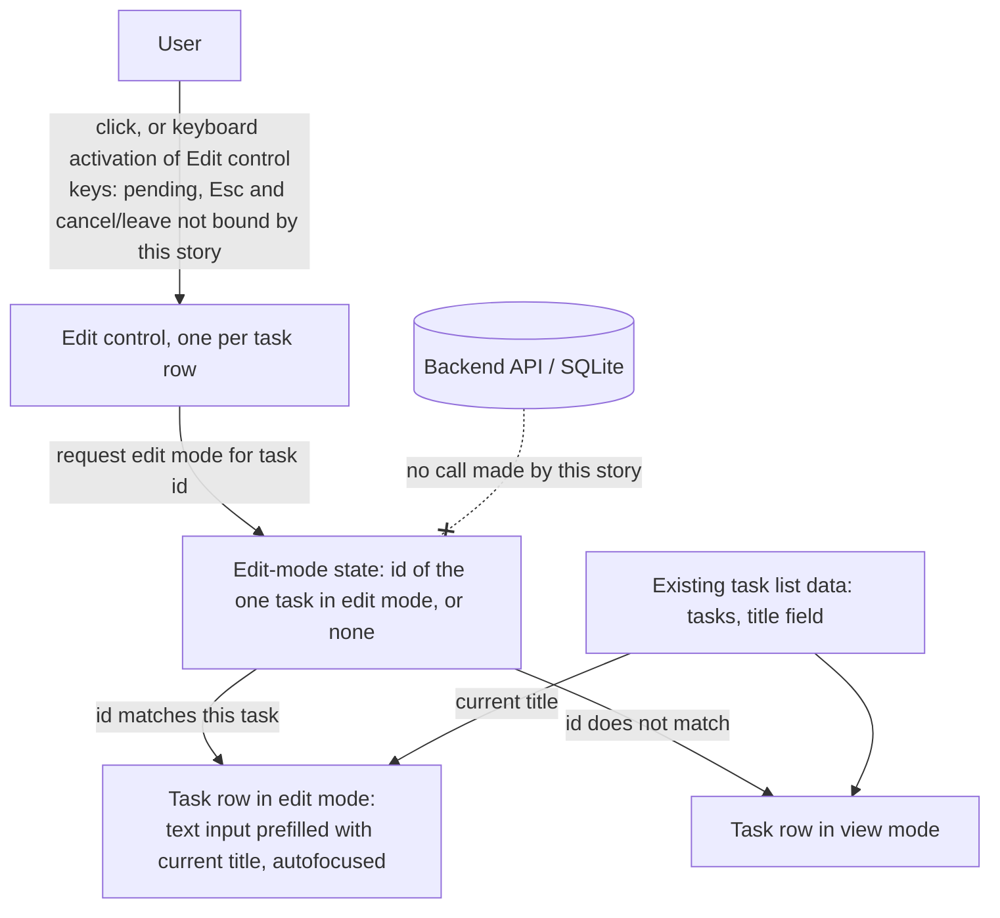

# Architecture — EPMCDMETST-66637: UI: Enter edit mode for a task from the task list

## Where this fits
TaskLite is a TypeScript app with a React frontend and an Express/Prisma backend on SQLite (`app-profile.yml`). This story touches the frontend only. The task list that already displays `tasks` gains a per-task Edit control and a single piece of UI state that records which task, if any, is currently in edit mode. The backend, the API and the database are not touched: entering edit mode makes no API call and writes no data (requirements, functional and Definition of Done).

The title-edit PATCH of EPMCDMETST-66640 is already merged and is existing context only. This story neither calls it nor depends on it. Saving, cancelling and leaving edit mode are out of scope (requirements, "Explicitly out of scope").

The pipeline does not read app source (G4), so the exact existing React components, files and hooks that render the task list are not known here. They are referred to below by role and marked [pending] where a concrete name or location would be needed.

## Picture

## Components and who does what
Names are role descriptions, not code identifiers. Concrete component names and file locations under `frontend/src` are [pending] until the human supplies them or Build reads the area it is told to change.

| Component | Responsibility | New / Changed |
|---|---|---|
| Task list (existing list that displays tasks) | Holds, or has access to, the edit-mode state described below. Renders each task in view mode or edit mode according to that state, so at most one task is in edit mode. Existing component name [pending]. | Changed |
| Task row / task item (existing per-task display) | Shows the Edit control in view mode. In edit mode shows the text input in place of the plain title (inline edit pattern from the story assumptions). Existing component name [pending]. | Changed |
| Edit control (per task) | A keyboard-reachable control on each task row. Activating it requests edit mode for that task. Exact keyboard keys (Enter/Space on the control) are [pending]. Esc, and any cancel or leave behaviour, is not bound by this story because leaving edit mode is out of scope; Esc stays listed only as a [pending] key carried from the requirements. | New |
| Edit input (per task, edit mode only) | Text input prefilled with the task's current `title`. Receives focus automatically when it appears, so the cursor is in the input and the current title is available for editing. | New |
| Edit-mode state (single value) | Records which task is in edit mode, by task `id`, or none. Setting it for one task implicitly returns every other task to view mode, which satisfies "only one task in edit mode". Where it lives (list-level component state or elsewhere) is a design choice for Build within the existing frontend; exact location [pending]. | New |

## Technology picks
Stays on the declared stack: TypeScript and React in `frontend/src`, tested with Vitest (`quality.test_tool`). No new dependency. Standard React state and focus handling are sufficient for a single in-memory value and one autofocused input, so no state-management or form library is justified. AC1 to AC3 are verified by Vitest component-level checks (prefilled value, focused input, only one row in edit mode); E2E tooling for EPMCDMETST-66824 and EPMCDMETST-66825 is [pending].

## How data moves
1. The task list already has the `tasks` data, including each task's existing `title`. No fetch or change to how it is loaded is introduced.
2. The user activates a task's Edit control (pointer or keyboard).
3. The edit-mode state is set to that task's `id`. Because it holds one value, any task previously in edit mode no longer matches and renders in view mode again.
4. The task whose `id` matches renders a text input whose initial value is its current `title`. The input takes focus on appearing (autofocus), which meets AC1 and AC2.
5. All other tasks stay in view mode (AC3).

No request is sent to the backend and nothing is persisted. There is no schema or entity change. The only entity involved is `tasks`, and only its existing `title` field is read (the `id` is used only to identify which row is in edit mode). No other entity or field is introduced.

## Contracts introduced or touched
- API: none. No endpoint is called, added or changed. The PATCH of EPMCDMETST-66640 is untouched.
- Data: none. `tasks` schema unchanged.
- UI contract, Edit control: present on every task row in the task list; reachable and activatable by keyboard alone (Definition of Done). Key bindings [pending]. Esc, and any cancel or leave behaviour, is not bound by this story because leaving edit mode is out of scope; Esc stays listed only as a [pending] key carried from the requirements.
- UI contract, edit mode: when entered, the row shows a text input whose value equals the task's current `title`, and that input has focus. At most one row is in edit mode at any time.
- UI contract, not defined here: how a task leaves edit mode (save, cancel, Esc) is out of scope and not specified by this architecture.
- Visual and interaction conventions: follow Release 1 UI conventions and the inline edit pattern. The specific conventions are [pending] (not in the story or app profile).
- Accessibility beyond keyboard entry (screen-reader labelling, focus order, and similar): [pending].

## Risks and assumptions
- Assumption: the existing task list already has each task's `title` available on the client, so no extra data is needed to prefill the input. This is inferred from the requirements (prefilled with the current title) and was not verified against source, as the pipeline does not read app source.
- Assumption: switching edit mode from one task to another discards whatever the user typed in the first input, because saving and cancelling are out of scope and no draft is kept. The human accepted this discard of unsaved typing when switching tasks.
- Risk: the exact keyboard keys are [pending]. If a native button is used for the Edit control, Enter and Space activation come with it, but this is not confirmed and no key choice is made here.
- Risk: Release 1 UI conventions are [pending]. Build cannot match them until the human describes them or points to a reference.
- Risk: performance and security expectations are [pending] (not stated in the story). Mitigating fact: the change is in-memory UI state with no API call and no data write.
- Risk: because the story is Closed in Jira and deliberately re-run in this repository, existing code in `frontend/src` may already contain related behaviour. This architecture is written as for new work, as the human confirmed; Build must reconcile with whatever it finds in the area it is told to change.
- Risk: autofocus on entering edit mode is intended (human answer on AC2). Moving focus programmatically can disorient assistive-technology users if not handled with care, so accessibility expectations beyond keyboard entry remain [pending].
- Edge paths: if the edit-mode id matches no rendered row, no row is in edit mode and nothing breaks. Any programmatic focus must tolerate an absent input.
- Scope: this story delivers only the entry point to edit mode. Leaving edit mode is covered by other work; the single-id-or-none state already allows a later story to return it to none.
